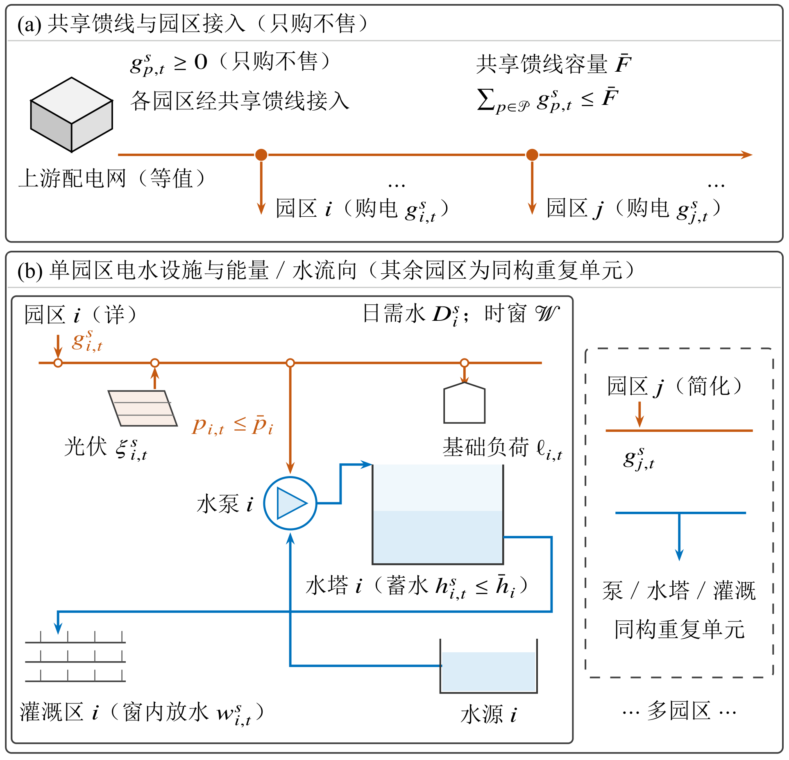

# 基于压力场景增广的农业园区电水规划运行校核方法

论文配套仓库（Paper Companion Repository），用于展示研究方法、实验平台、图件、汇总数据及加密代码材料。

## 论文信息

- **中文题名**：基于压力场景增广的农业园区电水规划运行校核方法
- **研究方向**：农业园区电水协同调度、压力场景增广、规划方案运行校核
- **论文状态**：尚未正式见刊

## 仓库内容

| 路径 | 内容 |
|---|---|
| `figures/` | 6张正文图和13张补充图，均为 PNG |
| `data/` | 汇总 CSV、数据来源与字段说明、核验摘要 |
| `encrypted/agri-park-energy-water-code.tar.gz.gpg` | 使用 OpenPGP AES-256 加密的代码与核验脚本包 |
| `MANIFEST_SHA256.csv` | 仓库文件的 SHA-256 清单 |

代码包包含调度、场景生成、统计、网络、制图及核验脚本，不包含模型权重、原始气象数据、逐日实验记录、预注册、论文 DOCX/PDF 或可编辑工程。

## 实验平台与网络拓扑

本研究使用**数值仿真平台**，不是实体硬件实验平台，主要包括两类拓扑：

- **双园区共享馈线**：上游配电网等值后通过共享馈线连接两个农业园区。每个园区均包含光伏、基础负荷、水泵、水塔和灌溉区；水源经泵送入水塔，再按灌溉时窗放水。共享馈线容量和园区蓄水共同形成电水耦合约束，模型设为只购电、不售电。
- **八园区配电网络**：将8个园区接入 IEEE 33节点和 IEEE 69节点配电网的指定母线，设置未绑定、临界绑定和持续绑定三类网络工况。规划层使用 LinDistFlow 电压约束，执行后逐时进行交流潮流复核。

时间分辨率为1小时，单个运行日为24小时。场景构造、计划调度、实际执行和网络校核分层处理，避免将线性规划结果直接等同于交流可行性。



## 数据信息

| 数据类别 | 内容与用途 | 时间范围与划分 | 公开形式 |
|---|---|---|---|
| 合成场景 | 光伏、需水、设备状态和网络工况的仿真场景，用于调度与消融实验 | 每组60个训练日、200个独立测试日；种子42—51 | 仅公开聚合结果 |
| 元谋站观测 | 山地科学数据中心的元谋干热河谷站气象观测，用于观测级对照 | 含太阳辐射数据集覆盖2019—2022年，常规气象数据集覆盖2022—2026年，逐时 | 不公开原始文件，给出来源与许可 |
| ERA5 / ERA5-Seamless | 经 Open-Meteo 获取的元谋与 Kericho 再分析气象驱动，包括辐射、气温、降水和风速等 | 元谋以2022—2023年训练、2025年测试；Kericho以2022—2023年训练、2024年测试 | 仅公开全年及季度汇总 |
| 配电网模型 | IEEE 33/69节点拓扑及园区接入关系，用于电压—经济联合校核 | 24小时逐时运行与网络场景回放 | 公开拓扑说明和聚合结果 |

元谋观测数据 DOI 为 [10.12380/Meteo.msdc.000059](https://doi.org/10.12380/Meteo.msdc.000059) 和 [10.12380/Meteo.msdc.000060](https://doi.org/10.12380/Meteo.msdc.000060)，按 CC BY 4.0 使用。再分析数据来自 [Open-Meteo Historical Weather API](https://open-meteo.com/)，按其数据条款使用。

**元谋站数据属于观测级气象对照，不等于农业园区田间实测；再分析结果与站点观测分开使用。** 完整的原始数据、逐日记录和字段级实验输入暂不公开，详见 [数据说明](data/README.md)。

## 主要结果

主算例采用10个种子、8个基础条目和12个最终场景。等权压力增广与普通日增广相比：

- **T95 降低61.1%**。
- **日均缺水降低69.1%**。

上述数值仅对应该算例与信息条件，详见 [主算例汇总](data/main_case_summary.csv)。网络预算、容量配置和方法配对结果分别见 [网络汇总](data/network_budget_summary.csv)、[容量汇总](data/capacity_summary.csv) 和 [配对统计](data/paired_method_summary.csv)。

外部全年回放同时保留正负方向：元谋主组差值均值为29.48元/日，正/零/负种子数为1/5/4；Kericho 组均值为199.03元/日，方向为5/5/0。均值不替代方向分布，详见 [外部回放汇总](data/external_replay_summary.csv) 和 [描述性统计](data/external_difference_stats.csv)。


## 运行环境与复现

- Python 3.12
- 基础依赖：NumPy、SciPy、pandas、Matplotlib、pandapower、pytest
- 图件依赖：PyMuPDF、Pillow、XeLaTeX、pdftocairo

当前代码以加密包形式提供，**未解密前不能运行**。获得解密密码后，可在仓库根目录执行：

```bash
gpg --output agri-park-energy-water-code.tar.gz --decrypt encrypted/agri-park-energy-water-code.tar.gz.gpg
tar -xzf agri-park-energy-water-code.tar.gz
cd code
python experiments/reproduce.py --list
python experiments/reproduce.py --suite smoke
```

[核验摘要](data/verification_summary.json) 记录30项测试、556项数字复核、网络归档复核、80次求解和29,220次逐日回放的结果。

## 数据与代码开放安排

**完整代码、实验数据、复现说明及代码包解密密码将在论文正式见刊后公开。** 在此之前，公开仓库提供项目介绍、图件、汇总结果和加密代码包；解密密码不随仓库发布，也不存放在仓库或 Git 历史中。

## 引用与使用

论文正式见刊后，请优先引用正式论文；仓库引用信息将同步补充。当前图件和结果仅作研究展示，不表示放弃著作权或授予再分发许可，第三方数据不随本目录分发。
