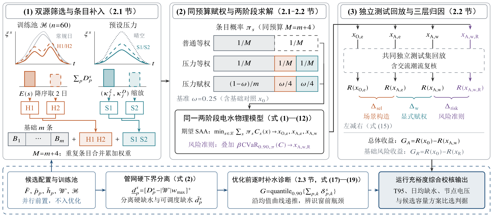

# 农业园区电水协同调度：研究展示

本目录用于公开展示农业园区电水协同调度的研究思路、图件和汇总结果。主题为**基于压力场景增广的农业园区电水规划运行校核方法**。

## 公开范围

- 20张 PNG 图件：7张正文图和13张补充图。
- 6份汇总 CSV：主算例、网络预算、容量配置、方法配对和外部回放结果。
- 1份核验摘要 JSON。

本目录**不包含**完整代码、模型权重、原始气象数据、逐日实验记录、预注册、论文 DOCX/PDF 或可编辑工程，不能用于重跑实验。完整代码与原始数据目前仅供授权的科研合作使用。

## 方法概览

方法从训练日的光伏与需水压力出发，将基础场景、高应力经验日和预设压力组合纳入同一预算，比较普通日增广、等权压力增广及问题驱动场景削减。调度层联合处理购电、光伏、泵、蓄水与灌溉时窗，并以独立测试回放、交流潮流复核和尾部分析评价方案。

## 结果概览

主算例采用10个种子、8个基础条目和12个最终场景。等权压力增广与普通日增广相比：

- T95 降低 **61.1%**。
- 日均缺水降低 **69.1%**。

上述数值仅对应该算例与信息条件，见 [主算例汇总](results/main_case_summary.csv)。网络预算、容量配置和方法配对结果分别见 [网络汇总](results/network_budget_summary.csv)、[容量汇总](results/capacity_summary.csv) 和 [配对统计](results/paired_method_summary.csv)。

外部全年回放同时保留正负方向。元谋主组差值均值为29.48元/日，正/零/负种子数为1/5/4；Kericho 组均值为199.03元/日，方向为5/5/0。均值不替代方向分布，详见 [外部回放汇总](results/external_replay_summary.csv) 和 [描述性统计](results/external_difference_stats.csv)。

## 基金资助

本项目得到以下基金支持：

- 中央引导地方科技发展资金（202607AB040001）。
- 中国南方电网有限责任公司科技项目（YNKJXM20240590）。

## 代码与数据公开说明

**代码、实验数据及复现说明将在论文正式见刊后公开。** 在此之前，本仓库仅提供项目介绍、图件、汇总结果和使用说明，不提供完整代码或原始实验输入。

## 查看方式

- 按 [图件索引](figures/README.md) 查看全部图片。
- 按 [结果说明](results/README.md) 理解指标、差值方向和统计边界。
- [核验摘要](results/verification_summary.json) 记录30项测试、556项数字复核、网络归档复核、80次求解和29,220次逐日回放的结果。

图件和结果仅作研究展示，不表示放弃著作权或授予再分发许可；第三方数据不随本目录分发。
