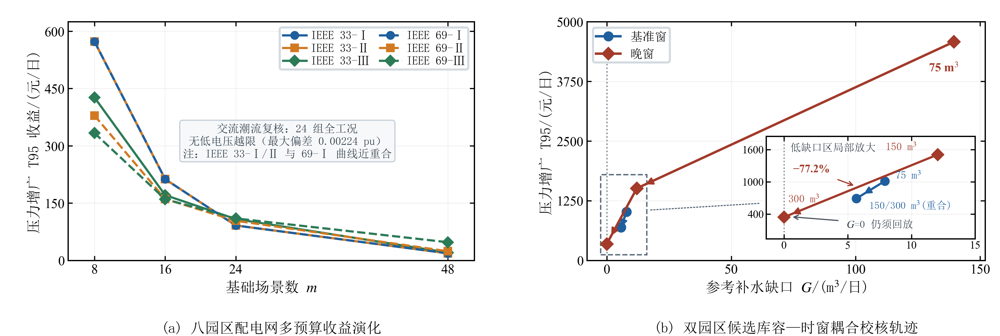

# 基于压力场景增广的农业园区电水规划运行校核方法

论文配套仓库（Paper Companion Repository），用于展示研究方法、图件、汇总结果及加密代码材料。

## 论文信息

- **中文题名**：基于压力场景增广的农业园区电水规划运行校核方法
- **研究方向**：农业园区电水协同调度、压力场景增广、规划方案运行校核
- **论文状态**：尚未正式见刊

## 仓库内容

| 路径 | 内容 |
|---|---|
| `figures/` | 7张正文图和13张补充图，均为 PNG |
| `results/` | 主算例、网络预算、容量配置、方法配对及外部回放的汇总 CSV 和核验摘要 |
| `encrypted/agri-park-energy-water-code.tar.gz.gpg` | 使用 OpenPGP AES-256 加密的代码与核验脚本包 |
| `MANIFEST_SHA256.csv` | 仓库文件的 SHA-256 清单 |

代码包包含调度、场景生成、统计、网络、制图及核验脚本，不包含模型权重、原始气象数据、逐日实验记录、预注册、论文 DOCX/PDF 或可编辑工程。

## 方法概览

方法从训练日的光伏与需水压力出发，将基础场景、高应力经验日和预设压力组合纳入同一预算，比较普通日增广、等权压力增广及问题驱动场景削减。调度层联合处理购电、光伏、泵、蓄水与灌溉时窗，并通过独立测试回放、交流潮流复核和尾部分析评价方案。


## 主要结果

主算例采用10个种子、8个基础条目和12个最终场景。等权压力增广与普通日增广相比：

- **T95 降低61.1%**。
- **日均缺水降低69.1%**。

上述数值仅对应该算例与信息条件，详见 [主算例汇总](results/main_case_summary.csv)。网络预算、容量配置和方法配对结果分别见 [网络汇总](results/network_budget_summary.csv)、[容量汇总](results/capacity_summary.csv) 和 [配对统计](results/paired_method_summary.csv)。

外部全年回放同时保留正负方向：元谋主组差值均值为29.48元/日，正/零/负种子数为1/5/4；Kericho 组均值为199.03元/日，方向为5/5/0。均值不替代方向分布，详见 [外部回放汇总](results/external_replay_summary.csv) 和 [描述性统计](results/external_difference_stats.csv)。



## 运行环境与复现

- Python 3.12
- 基础依赖：NumPy、SciPy、pandas、Matplotlib、pandapower、pytest
- 图件依赖：PyMuPDF、Pillow、XeLaTeX、pdftocairo

当前代码以加密包形式提供，**未解密前不能运行**。获得解密密码后，可在仓库根目录执行：

```bash
gpg --output agri-park-energy-water-code.tar.gz --decrypt encrypted/agri-park-energy-water-code.tar.gz.gpg
tar -xzf agri-park-energy-water-code.tar.gz
cd code
python experiments/reproduce.py --list
python experiments/reproduce.py --suite smoke
```

[核验摘要](results/verification_summary.json) 记录30项测试、556项数字复核、网络归档复核、80次求解和29,220次逐日回放的结果。

## 数据与代码开放安排

**完整代码、实验数据、复现说明及代码包解密密码将在论文正式见刊后公开。** 在此之前，公开仓库提供项目介绍、图件、汇总结果和加密代码包；解密密码不随仓库发布，也不存放在仓库或 Git 历史中。

## 基金资助

本项目得到以下基金支持：

- 中央引导地方科技发展资金。
- 中国南方电网有限责任公司科技项目。

## 引用与使用

论文正式见刊后，请优先引用正式论文；仓库引用信息将同步补充。当前图件和结果仅作研究展示，不表示放弃著作权或授予再分发许可，第三方数据不随本目录分发。
